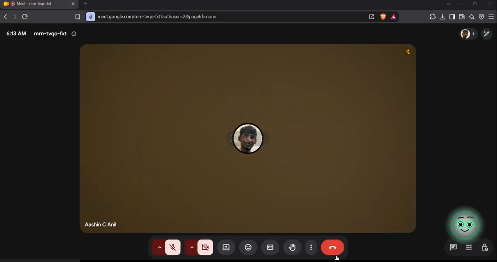
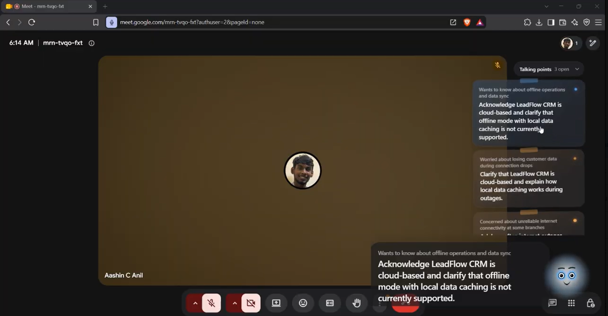
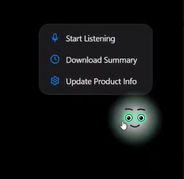
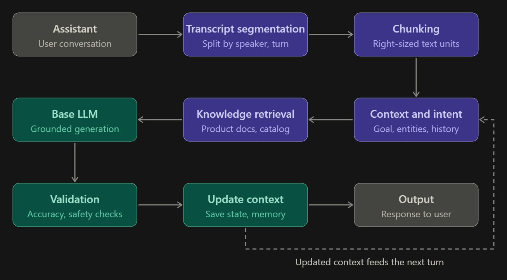

# DEFINE 4.0

The official project submission repository for **DEFINE 4.0 — The World's Realest Hackathon**.

---

# Nudge


## Team Information

- **Team Name**: Meltdown
- **Track**: General

## Team Members

| Name | Role | GitHub | LinkedIn |
|------|------|--------|----------|
| Aashin C Anil | Backend Dev | [@username](https://github.com/Aashin20) | [Profile](https://linkedin.com/in/aashin-c-anil/) |
| Abia C Anil | Frontend Dev | [@username](https://github.com/abiacanil) | [Profile](https://linkedin.com/in/abiacanil) |

---

# Project Details

## Overview

Nudge is a real-time AI sales assistant that listens to sales conversations, understands customer needs, and provides timely suggestions to help sales representatives respond confidently. Nudge helps salespeople avoid missed opportunities, handle objections, and make better decisions during conversations.

## Problem Statement

Sales representatives must simultaneously understand customer needs, handle objections, recall product information, and identify buying signals during fast-paced conversations. This cognitive overload can lead to missed opportunities, forgotten details, and inaccurate responses, affecting sales performance and customer trust. Existing tools primarily focus on recording conversations and analyzing them after they end, leaving representatives without timely, context-aware assistance when it matters most.

## Solution

A real-time assistant that transcribes live conversations, maintains evolving customer context, and provides concise, actionable suggestions. It detects objections, buying signals, and potential unsupported claims while automatically generating call summaries, commitments and follow-up actions. 


---

# Demo

### Demo Video

[Watch Project Demo](https://drive.google.com/file/d/1wjRAmS9bh4ZBEh1v9AYsKsDWRjwsgV2H/view?usp=drive_link)


### Screenshots

<!-- Add screenshots of your project here -->







---


# Technical Implementation

## Technologies Used

| Category | Technologies |
|----------|--------------|
| **Frontend** | Vue 3, Vite, Electron |
| **Backend** | FastAPI, Uvicorn |
| **Database** | SQLite |
| **APIs / Services** |  Gemini, ElevenLabs  |
| **AI / ML** | Faster-Whisper, sound-card audio capture, NumPy, Gemini LLM inference |
| **DevOps / Deployment** | Electron packaging, Vite build pipeline, local desktop app deployment |
| **Other Tools** | ReportLab |

## System Architecture

<!-- Add your architecture diagram here -->



## Key Features

- Live Sales Suggestions
- Automatic Summary document after the call
- Live Notes
- Mulitlingual support(90+ languages)
- Rolling Context

---

# Setup Instructions

## Prerequisites

Before running Meltdown, make sure you have the following installed:

- Python 3.11+
- Node.js 22.18+ (or a compatible LTS version)
- npm
- Git
- A working microphone and speaker setup for voice capture

## Installation

### 1. Clone the Repository

```bash
git clone https://github.com/Aashin20/Meltdown.git
cd Meltdown
```

### 2. Create a Python Environment and Install Backend Dependencies

```bash
python -m venv .venv
.\.venv\Scripts\Activate.ps1
python -m pip install --upgrade pip
pip install -r requirements.txt
```

### 3. Configure Environment Variables

Create a `server/.env` file in the project root and add your API keys:

```env
GEMINI_API_KEY=your_gemini_api_key
ELEVEN_LABS_API_KEY=your_elevenlabs_api_key
MODEL=gemini-3.5-flash-lite
```

> If you do not have Gemini or ElevenLabs credentials yet, sign up for both services and add the generated keys before launching the app.

### 4. Install Frontend Dependencies

```bash
cd overlay\Overlay
npm install
```

## Running the Project

### Option A: Run the Backend and Web Overlay Separately

From the repository root, start the FastAPI backend:

```bash
.\.venv\Scripts\Activate.ps1
uvicorn server.app:app --host 127.0.0.1 --port 8000 --reload
```

In a second terminal, start the Vue overlay app:

```bash
cd overlay\Overlay
npm run dev
```

Then open the local Vite app in the browser and ensure the frontend is configured to call `http://127.0.0.1:8000`.

### Option B: Run the Desktop App

From the overlay folder:

```bash
cd overlay\Overlay
npm run desktop:dev
```

This starts the Electron desktop overlay and automatically launches the backend when configured.

